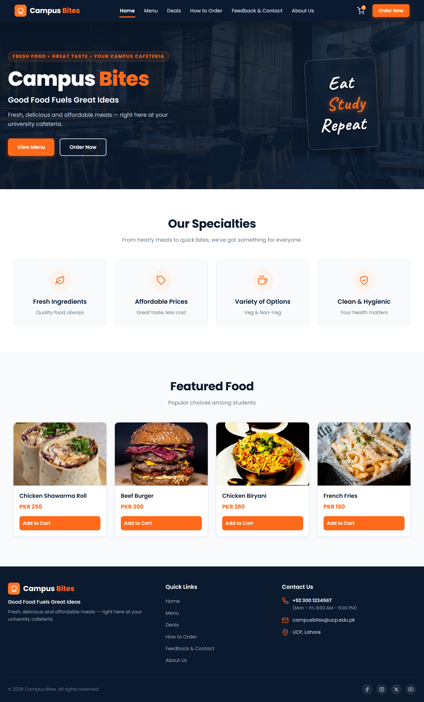

<div align="center">

# 🍔 Campus Bites — Cafeteria Website
**DevOps Fundamentals (SEST4663) | University of Central Punjab (UCP)**

[](https://l1f23bsse0176.github.io/campus-bites/src/index.html)
[](https://ucp.edu.pk/)
[](https://github.com/L1F23BSSE0176/campus-bites)
[](https://github.com/L1F23BSSE0176/campus-bites)

<p align="center">
  A clean, responsive cafeteria website built by a team of 6 students using Git collaboration, branch protection rules, and rebase workflows.
</p>

[👉 Click Here to Open Live Website](https://l1f23bsse0176.github.io/campus-bites/src/index.html)

---

### 🖥️ Website Preview


</div>

---

## 📌 Project Overview
**Campus Bites** is a static website designed for the university cafeteria at the **University of Central Punjab (UCP)**. It helps students, teachers, and visitors:
- View the daily food menu and prices in PKR.
- Check special student deals and combo discounts.
- Learn the simple step-by-step ordering process and timings.
- Submit feedback and inquiries through an online contact form.
- Read about cafeteria hygiene rules, timings, and location.

---

## ⚡ Project Rules & Technology
- **Pure HTML5 & CSS3:** No JavaScript or external frontend frameworks were used, strictly following assignment requirements.
- **One Shared CSS File:** All 6 pages use a single stylesheet (`styles/style.css`).
- **Fully Responsive:** Uses CSS Media Queries (`992px`, `768px`, `480px`) so the website looks great on mobiles, tablets, and laptops.
- **Unified Design:** Same navigation bar, orange & navy theme, and footer across all pages.

---

## 👥 Team Members & Responsibilities (Table 1)

| Sr # | Name | Student ID | GitHub | Role | Assigned Work / Branch |
| :---: | :--- | :--- | :--- | :---: | :--- |
| **1** | **Laheem Ayub** | `L1F23BSSE0176` | [@L1F23BSSE0176](https://github.com/L1F23BSSE0176) | **Team Lead** | `features/home-page`<br>*(Repo setup, branch management, theme unification)* |
| **2** | **Muhammad Owais** | `L1F23BSSE0145` | [@L1F23BSSE0145](https://github.com/L1F23BSSE0145) | **Member** | `feature/Deals-page`<br>*(Daily deals, combos, student discounts)* |
| **3** | **Muhammad Saad** | `L1F23BSSE0177` | [@L1F23BSSE0177](https://github.com/L1F23BSSE0177) | **Member** | `feature/menu-page`<br>*(Menu items with prices in PKR)* |
| **4** | **Muhammad Umar** | `L1F23BSSE0137` | [@L1F23BSSE0137](https://github.com/L1F23BSSE0137) | **Member** | `feature/feedback-page`<br>*(Feedback form, contact info, cafeteria timings)* |
| **5** | **Irtaza Naseer** | `L1F23BSSE0178` | [@L1F23BSSE0178](https://github.com/L1F23BSSE0178) | **Member** | `feature/order`<br>*(Ordering steps, payment methods, pickup rules)* |
| **6** | **Muhammad Nouman** | `L1F23BSSE0233` | [@L1F23BSSE0233](https://github.com/L1F23BSSE0233) | **Member** | `feature/about-page`<br>*(About cafeteria, hygiene standards, opening hours)* |

---

## 📄 Website Pages

| Page | File | What it does |
| :--- | :--- | :--- |
| **Home** | [`src/index.html`](./src/index.html) | Main landing page with welcome hero section, specialties, and top food items. |
| **Menu** | [`src/menu-Page.html`](./src/menu-Page.html) | Categorized menu: Burgers, Wraps, Rice & Biryani, Snacks, and Drinks. |
| **Deals** | [`src/dealPage.html`](./src/dealPage.html) | Budget combo meals and special discounts for UCP students. |
| **How to Order** | [`src/order.html`](./src/order.html) | 4 easy steps to place an order, payment options (Cash, Card, JazzCash/Easypaisa). |
| **Feedback** | [`src/feedback.html`](./src/feedback.html) | Feedback form to submit suggestions, plus contact phone and email. |
| **About Us** | [`src/about-page.html`](./src/about-page.html) | Cafeteria history, hygiene promise, statistics, and weekly schedule. |

---

## 🛠️ Git & DevOps Workflow

We followed the professional **Git Flow** strategy to collaborate smoothly and avoid code breaking:

```text
       [feature/home-page]  [feature/menu-page]  [feature/Deals-page]  ...
               \                  /                   /
                v                v                   v
develop ───────●────────────────●───────────────────●─────────── (All features merged here)
                                                     \
                                                      v
                                              release/v1.0 ───── (Testing & bug fixing)
                                                     / \
                                                    /   v
main ──────────────────────────────────────────────●─────●───── (Final live code)
```

### 1. Branch Structure
- **`main`**: Stores the final, tested, production-ready website.
- **`develop`**: Main workspace where all team feature branches are merged.
- **`release/v1.0`**: Branch used for final quality check and testing before going live.
- **`feature/*`**: Each member worked in their own separate branch to avoid disturbing others.

### 2. Branch Protection Rules
GitHub rules were set up to protect our main code:
- **No Direct Push:** Nobody can push directly to `develop` or `main`.
- **Pull Requests (PR):** Every update must go through a PR.
- **Peer Approvals:**
  - Need at least **2 approvals** to merge into `develop`.
  - Need at least **3 approvals** to merge into `main`.

### 3. Rebase & Conflict Resolution
Before merging any Pull Request, every member updated their branch using `git rebase`:
```bash
# Get the latest changes from develop
git fetch origin
git rebase origin/develop

# If there were any conflicts in styles/style.css, we solved them locally
git add styles/style.css
git rebase --continue

# Push updated feature branch safely
git push origin <your-branch-name> --force-with-lease
```

---

## 📁 Folder Structure

```text
campus-cafeteria/
│
├── .github/
│   └── assets/
│       └── home-preview.png     # Screenshot for README
│
├── .gitignore                   # Files Git should ignore
├── README.md                    # Project documentation
│
├── src/                         # All website HTML pages
│   ├── about-page.html
│   ├── dealPage.html
│   ├── feedback.html
│   ├── index.html
│   ├── menu-Page.html
│   └── order.html
│
└── styles/
    └── style.css                # Single shared CSS file
```

---

## 💻 How to Run Locally

1. **Clone the repo:**
   ```bash
   git clone https://github.com/L1F23BSSE0176/campus-bites.git
   ```

2. **Go to folder:**
   ```bash
   cd campus-bites
   ```

3. **Open the site:**
   - Double-click `src/index.html` to open it in your browser.
   - Or in VS Code, right-click `src/index.html` and choose **"Open with Live Server"**.

---

## 🎓 Academic Details
- **Course:** DevOps Fundamentals (SEST4663)
- **Class:** BS Software Engineering (BS-SE)
- **University:** University of Central Punjab (UCP), Lahore
- **Instructor:** Imran Ashraf
- **Semester:** Fall 2026
